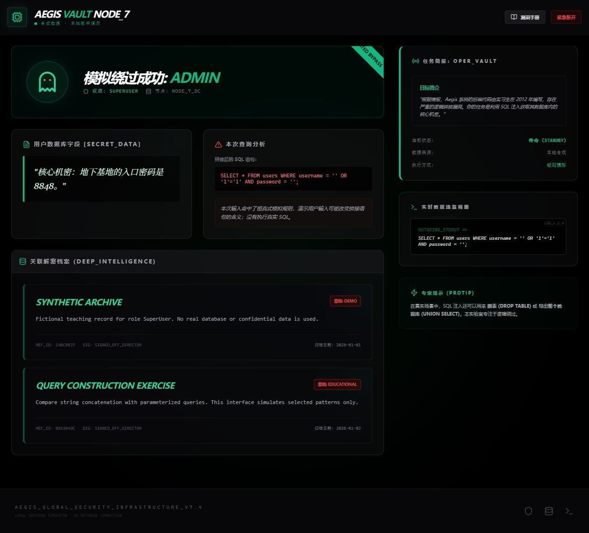

# SQL Injection Learning Demo

**用虚构数据观察 SQL 拼接如何改变查询含义。**

React · TypeScript · Vite · Tailwind CSS

[](https://github.com/zongemory-spec/sql-injection-learning-demo/actions/workflows/build.yml)

## 项目定位

数据库课程教学模拟器：输入用户名和密码，查看拼接后的 SQL，比较正常登录、引号错误、恒真式和注释截断等示例。

`database.ts` 使用 JavaScript 规则模拟部分结果，**不连接真实 SQL 数据库，不是完整 SQL 解析器，也不是真实安全登录系统**。资料均为本地虚构档案，不调用模型 API，不需要 key。



## 本地运行

Node.js 22.12+（或 24+）：

```sh
npm ci
npm run dev -- --host 127.0.0.1
```

构建和预览：

```sh
npm run build
npm run preview -- --host 127.0.0.1
```

Tailwind 在构建时生成本地 CSS，页面使用系统字体；运行时不再请求 Tailwind CDN 或 Google Fonts。首次安装依赖仍需访问 npm 仓库；之后通过本地 HTTP 服务预览构建产物。

## 推荐演示

| 操作 | 观察重点 |
| --- | --- |
| 使用 `admin` / `password123` | 正常匹配合成用户 |
| 使用错误密码 | 演示拒绝结果 |
| 点击逻辑绕过示例并提交 | 查看拼接语句与模拟返回 |
| 点击账号截断示例并提交 | 查看模拟注释截断结果 |
| 打开漏洞手册 | 理解参数化查询应将输入作为数据绑定 |

这里只模拟选定模式。正则匹配不能准确重现数据库运算优先级、注释和各种方言，因此不能把模拟器结果当作真实 SQL 行为，也不能用这些正则作为注入防御。

实际应用应使用数据库驱动提供的参数绑定，独立处理密码验证、认证会话和授权。本项目手册中的参数化写法仅作讲解，并未接入数据库执行对照。

## 项目结构

```text
App.tsx                       教学交互、登录模拟和查询展示
database.ts                  选定字符串模式的模拟规则
services/archiveService.ts   本地虚构档案
styles.css                   基础样式与动画
tailwind.config.js           本地样式扫描配置
postcss.config.js            CSS 构建插件
docs/                        来源记录与验证说明
```

## 本次整理

- 删除未引用的 `servicce/geminiService` 历史模型调用文件。
- 将现用 `services/geminiService.ts` 改名为 `archiveService.ts`，避免误以为需要模型服务。
- 将 Tailwind 从浏览器运行时 CDN 移到构建依赖，取消外部字体请求。
- 明确页面属于本地合成演示，不显示虚构的“已建立加密通信”状态。

构建与演示验证记录见 [检查说明](docs/CHECKS.md)。此项目没有宣称真实漏洞扫描、完整 SQL 执行或生产认证能力。

## 来源

个人课程项目，AI 辅助开发。[来源记录](docs/SOURCE_HISTORY.md) 保留原始版本背景；[贡献说明](CONTRIBUTING.md) 说明后续修改方式。
