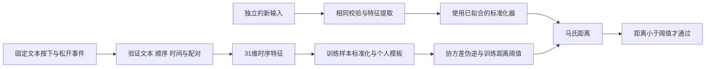

<div align="center">

# Keystroke Dynamics Authentication

**从一次输入的节奏，理解行为特征与身份验证的边界。**

击键动力学身份认证 · 个人课程实验 · AI 辅助开发  
Python · Flask · NumPy · pandas · scikit-learn

[实验方法](docs/EXPERIMENT.md) · [合成验证](reports/showcase-evidence.json) · [自动检查](https://github.com/zongemory-spec/keystroke-authentication/actions)

[](https://github.com/zongemory-spec/keystroke-authentication/actions/workflows/tests.yml)
[](LICENSE)

</div>

---

## 背景与目标

同样输入 `hello world`，不同人的按键持续时间、相邻键间隔和交叠方式可能不同。这个实验将浏览器按键事件转成时序特征，用个人模板与距离阈值演示身份验证。

目标不是替代生产登录系统，而是完成一个可解释的闭环：**采集事件 → 校验顺序与配对 → 提取特征 → 建立模板 → 用新输入比较距离和阈值**，同时明确样本划分、输入可信度与评测限制。

## 演示流程



浏览器提供采集、状态计数、模板构建和验证反馈。无需真人样本也可运行合成证据脚本；它经过真实 Flask 路由，使用临时数据完成同一条管线，不操作日常样本。

```sh
python demo_evidence.py --out reports/my-evidence.json
```

合成输入用于检查实现，不是人类生物特征实验。真人界面演示和评测准备步骤见 [实验指南](docs/EXPERIMENT.md)。

## 核心实现与取舍

| 问题 | 实现 | 为什么这样做 |
| --- | --- | --- |
| 重复字母与松开顺序不同 | 按下顺序校验固定文本，按键配对各自的松开事件 | 不能直接按松开次序拼接特征 |
| 正常键盘交叠被误判异常 | 保留有效的负 Up–Down 间隔 | 后一个键可在前一个键松开前按下 |
| 各维时序尺度不同 | StandardScaler 仅拟合训练样本 | 新输入复用同一个标准化器 |
| 协方差可能奇异 | 使用 NumPy 伪逆计算距离 | 31 维存在固定线性关系，不是完全独立特征 |
| 个人节奏不同 | 每用户保存模板与阈值 | 当前是单用户异常检测，不是多分类识别人群 |
| 非法输入写入或读取本地文件 | 严格 JSON、用户 ID、路径和链接文件校验；64 KiB 请求上限 | 拒绝非法结构、非有限时间和目录穿越 |

### 31 维特征是什么

| 特征 | 含义 | 数量 |
| --- | --- | ---: |
| Hold | 同一个键从按下到松开 | 11 |
| Down–Down | 相邻两个键按下的间隔 | 10 |
| Up–Down | 前键松开到后键按下的间隔，可为负 | 10 |

对前十个键，`Down–Down - Up–Down = Hold`。因此“31 维”不等于 31 个独立自由度；伪逆处理相关性，但不自动解决泛化和小样本问题。

当前阈值为训练距离的 `mean + 1.7 × std`，距离严格小于阈值才通过。至少 32 条是当前代码的建模门槛，建议 50 条以上；不能把这个门槛当作充分的统计保证。

## 本地运行

使用 Python 3.12，在仓库根目录执行：

```powershell
python -m venv .venv
.\.venv\Scripts\python.exe -m pip install -r requirements.txt
.\.venv\Scripts\python.exe app.py
```

macOS / Linux 将解释器路径换成 `.venv/bin/python`。打开 http://127.0.0.1:5000 。

1. 使用演示代号选择用户，自然输入 `hello world`，松开全部键后采集。
2. 达到样本要求后建立模板；不要复制同一样本凑数量。
3. 切换验证，用新输入查看距离、阈值与通过/拒绝。

服务仅绑定本机，关闭 Flask debug。CSV 与模型路径固定在项目目录，不随启动终端的位置改变。更新旧版前备份自己的数据；旧 CSV 缺少原始事件，不能追溯证明其配对正确性。

## 测试与结果

```sh
python -m unittest discover -s tests -v
python demo_evidence.py --out reports/my-evidence.json
```

本次本地验证日期：**2026-10-31**。

| 检查 | 实测结果 |
| --- | --- |
| 全部回归测试 | 29 项通过（原有 26 项 + 新增 3 项） |
| 合成流程与输入检查 | 11 个场景符合预期 |
| 同分布留出输入 | 14 / 20 被接受，仅代表该生成器 |
| 明显改变节奏的输入 | 0 / 20 被接受，不代表真实冒用者 FAR |
| 合成训练协方差秩 | 21，对应特征线性相关性 |

即使同分布合成样本也有 6 条被拒绝，说明当前训练内阈值不是泛化保证。后续应使用独立开发集校准，而不是为提高这张表的数字反复调整随机样本。

结果记录见 [合成报告](reports/showcase-evidence.json) 与 [本次测试日志](reports/showcase-tests.txt)。最新自动检查以 [Actions](https://github.com/zongemory-spec/keystroke-authentication/actions) 对应提交为准。

合成脚本分别生成 80 条训练、20 条同分布留出、20 条改变节奏的留出样本。三组 seed 不交叠，验证不会追加训练样本；接受数量只作观察，不作为安全测试通过条件。

回归覆盖重复字符、有效键交叠、时间和事件结构错误、非法用户 ID、目录穿越、请求大小、链接文件、损坏 CSV、无变化样本，以及采集→建模→验证接口。新增证据测试还检查训练/留出划分，以及校验退化时报告能否判为失败。

**目前没有真实参与者的独立测试集，因此不报告真实 FAR、FRR、EER 或总体认证准确率。** 训练内距离和随机时序不能代替真人泛化测试。后续评测协议见 [实验方法](docs/EXPERIMENT.md)。

## 代码阅读入口

| 文件 | 关注点 |
| --- | --- |
| `index.html` | 浏览器事件采集、状态和距离反馈 |
| `app.py` | JSON 校验、采集、建模和认证路由 |
| `auth.py` | 事件配对、特征、标准化、个人模板与阈值 |
| `demo_evidence.py` | 临时合成数据管线与可复现报告 |
| `tests/` | 数值、路径、协议和 API 回归 |

## 已知限制与后续方向

- 事件协议校验无法证明是真人输入，也不防止重放；本原型不是安全登录服务。
- 阈值从训练内分布计算，尚未用跨会话本人样本和真实冒用尝试校准。
- 特征存在冗余，伪逆与阈值的稳定性仍需结合样本数和独立测试分析。
- 本地模板使用 pickle，仅加载自己生成且控制的文件；不接收外部 pickle。
- 尚无活体判断、生产认证会话、完善限流、模板加密或多设备泛化结论。

后续优先在知情同意下建立按会话划分的独立数据集，冻结阈值后报告 FAR/FRR；再比较精简特征、正则化协方差与当前伪逆基线。暂不将这些计划写成已完成成果。

## 来源与许可

个人课程项目，AI 辅助开发。[来源记录](docs/SOURCE_HISTORY.md) 保留版本背景，[贡献说明](CONTRIBUTING.md) 说明本地工作流。

代码采用 [MIT License](LICENSE)。真实击键样本和派生身份模板保持本地，不提交到公共仓库。
